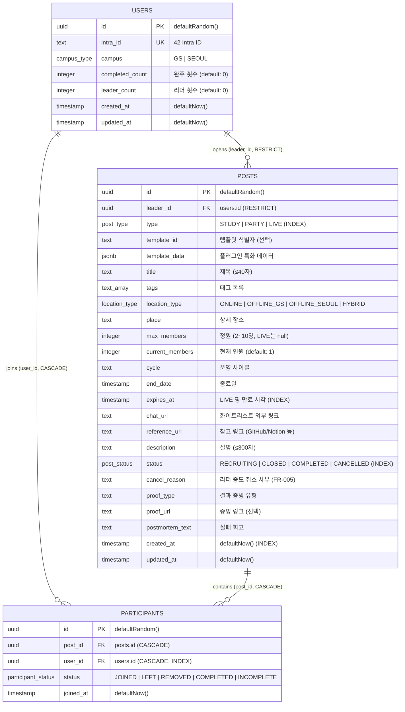

# [TRD] 모두의 42 (Modu-42) — 기술 요구사항 명세서

* **문서 버전:** v2.1 (Phased Milestone & Production-Ready)
* **대상:** 프로덕션 서비스 운영 수준 아키텍처 및 구현 명세
* **개발 방법론:** Spec-Driven Development (`speckit`) + Vitest 기반 TDD
* **연관 문서:** [requirement.md](./requirement.md) (요구사항 정의서), [speckit-guide.md](./speckit-guide.md) (speckit 가이드), [plan.md](./plan.md) (기획서), [prd.md](./prd.md) (기능 명세서)

---

## 1. 기술 스택 (Tech Stack)

| 영역 | 선택 기술 | 선정 이유 및 역할 |
| :--- | :--- | :--- |
| **Frontend** | Next.js 14 (App Router) + TypeScript + Tailwind CSS | React Server Components(RSC)를 통한 초기 렌더링 최적화 및 SEO |
| **Backend** | Next.js Route Handlers (`app/api/**`) | Vercel Serverless Function 기반 경량 API 레이어 |
| **ORM** | **Drizzle ORM** + `drizzle-kit` | 제로 런타임 오버헤드, 엄격한 TypeScript 타입 추론, 원자적 트랜잭션(`db.transaction`) |
| **Database** | **Supabase (PostgreSQL)** | 원격 개발/상용 PostgreSQL 인스턴스, Connection Pooling, 강력한 RLS |
| **Realtime** | **Supabase Realtime Engine** | PostgreSQL WAL(Write-Ahead Log) 기반 실시간 브로드캐스트 (LIVE 핑, 실시간 참여자 수) |
| **Authentication** | Phase 0~3: 로컬 Mock 쿠키 세션<br>Phase 4: 42 Intra OAuth 2.0 PKCE + Supabase Auth | 개발 단계 속도 최적화 및 상용 42 멤버 인증 연동 |
| **Testing** | **Vitest** | 초고속 단위/통합 테스트, 실제 DB 트랜잭션 롤백 기반 동시성/비즈니스 로직 검증 |
| **Workflow** | **speckit (Spec Kit)** | `specify` → `plan` → `tasks` → `implement` 4단계 루프 기반 사양 주도 개발 |
| **CI/CD & Deploy** | GitHub Actions + Vercel | PR 자동 테스트/린트 검증, Vercel 자동 프리뷰/프로덕션 배포 |

---

## 2. 인증 및 인가 아키텍처 (Auth Architecture)

### 2.1 [Phase 0~3] 개발 환경 Mock 인증 아키텍처
42 OAuth 연동 전까지 빠르고 독립적인 TDD 및 기능 검증을 위해 로컬 Mock 인증 체계를 운영합니다.

```text
[개발자 UI] ──(클릭)──> [MockAuthModal]
                             │
                             ▼
                    POST /api/mock-auth
              (쿠키: modoo42_mock_user 주입)
                             │
                             ▼
                 서버 공통: getCurrentUser()
       (쿠키 파싱 -> DB users 테이블 매핑/Upsert)
```

1. **Mock 페르소나 정의 (3종):**
   - `gs_leader`: 경산 캠퍼스 리더 (`campus: 'GS'`, 기존 작성 글 다수 보유)
   - `gs_member`: 경산 캠퍼스 일반 참여자 (`campus: 'GS'`)
   - `seoul_member`: 서울 캠퍼스 멤버 (`campus: 'SEOUL'`)
   - `guest`: 로그아웃 상태
2. **세션 쿠키 발급:** `/api/mock-auth` 호출 시 `modoo42_mock_user` 쿠키에 선택한 페르소나 식별자를 기록.
3. **공통 세션 추상화 (`src/lib/auth.ts`):**
   - `getCurrentUser()` 함수 제공.
   - 개발 환경(`NODE_ENV === 'development'`): `modoo42_mock_user` 쿠키를 읽어 `users` 테이블의 Mock 레코드 반환.
   - 상용 배포 환경: 자동으로 Mock API 및 UI 모달 비활성화, Phase 4의 실제 세션 검증으로 대체.

### 2.2 [Phase 4] 프로덕션 42 Intra OAuth 2.0 PKCE 플로우

1. **로그인 시작:** 유저 `[42로 로그인]` 클릭 → 42 OAuth 인가 엔드포인트 리다이렉트 (PKCE + `state` 검증).
2. **토큰 교환:** 콜백(`/api/auth/callback`)에서 `code` 수신 → 42 API로 `access_token` 교환.
3. **캠퍼스 파싱:** 42 `/v2/me` 호출하여 `login`(`intra_id`), `campus_users` 조회 → `GS`(경산) 또는 `SEOUL`(서울) 매핑.
4. **계정 동기화:** Drizzle ORM으로 `users` 테이블에 Upsert.
5. **장기 세션 쿠키 발급:** 30일 지속성(`Max-Age=2592000`, `HttpOnly`, `Secure`, `SameSite=Lax`) 세션 쿠키 발급.
6. **Zero-Click 라우팅 (`middleware.ts`):**
   - **미인증 유저:** 보호 라우트(`/dashboard`, `/create`) 접근 시 소개 랜딩(`/login`)으로 307 리다이렉트.
   - **인증 유저:** 랜딩(`/login`) 접근 시 0초 만에 `/dashboard`로 직행.
   - **DB 보안:** Supabase RLS 및 Route Handler에서 `session.user.id == post.leader_id` 이중 검증.

---

## 3. 데이터베이스 스키마 및 ERD 명세 (Drizzle ORM)

### 3.1 ERD 다이어그램 (Mermaid)



### 3.2 Drizzle ORM 스키마 코드 (`src/db/schema.ts`)

```typescript
// src/db/schema.ts
import { pgTable, uuid, text, timestamp, integer, pgEnum, jsonb, uniqueIndex, index } from 'drizzle-orm/pg-core';
import { relations } from 'drizzle-orm';

export const campusEnum = pgEnum('campus_type', ['GS', 'SEOUL']);
export const postTypeEnum = pgEnum('post_type', ['STUDY', 'PARTY', 'LIVE']);
export const postStatusEnum = pgEnum('post_status', ['RECRUITING', 'CLOSED', 'COMPLETED', 'CANCELLED']);
export const locationTypeEnum = pgEnum('location_type', ['ONLINE', 'OFFLINE_GS', 'OFFLINE_SEOUL', 'HYBRID']);
export const participantStatusEnum = pgEnum('participant_status', ['JOINED', 'LEFT', 'REMOVED', 'COMPLETED', 'INCOMPLETE']);

export const users = pgTable('users', {
  id: uuid('id').defaultRandom().primaryKey(),
  intraId: text('intra_id').unique().notNull(),
  campus: campusEnum('campus').notNull(),
  completedCount: integer('completed_count').default(0).notNull(),
  leaderCount: integer('leader_count').default(0).notNull(),
  createdAt: timestamp('created_at', { withTimezone: true }).defaultNow().notNull(),
  updatedAt: timestamp('updated_at', { withTimezone: true }).defaultNow().notNull(),
});

export const posts = pgTable('posts', {
  id: uuid('id').defaultRandom().primaryKey(),
  leaderId: uuid('leader_id').references(() => users.id, { onDelete: 'restrict' }).notNull(),
  type: postTypeEnum('type').notNull(),
  
  // [책장/플러그인 아키텍처] 템플릿 식별자 (예: 'cote', 'commit', 'reading', 'duolingo', 'music', 'custom')
  templateId: text('template_id'),
  
  // [책장/플러그인 아키텍처] 템플릿 전용 특화 데이터 (JSONB, Phase 2 고도화)
  // - 새로운 스터디 유형 추가 시 DB 스키마 수정 없이 TypeScript 정의 PR만으로 확장
  templateData: jsonb('template_data').$type<Record<string, unknown>>(),

  title: text('title').notNull(),
  tags: text('tags').array().notNull(),
  locationType: locationTypeEnum('location_type').notNull(),
  place: text('place'), // 온/오프라인 상세 장소 또는 클러스터 좌석
  maxMembers: integer('max_members'), // 스터디/파티: 2~10명(Zod 검증), LIVE 핑: 미사용(null)
  currentMembers: integer('current_members').default(1).notNull(), // 리더 포함 1명 시작
  cycle: text('cycle'),
  endDate: timestamp('end_date', { withTimezone: true }),
  expiresAt: timestamp('expires_at', { withTimezone: true }), // LIVE 핑 만료 시각
  chatUrl: text('chat_url'), // 스터디/파티: 화이트리스트 URL 필수(Zod 검증), LIVE 핑: 미사용(null)
  referenceUrl: text('reference_url'), // 참고 링크 (GitHub/Notion 등)
  description: text('description'),
  status: postStatusEnum('status').default('RECRUITING').notNull(),
  cancelReason: text('cancel_reason'), // 리더 중도 취소 사유 (FR-005). 취소 시에만 채워진다.
  proofType: text('proof_type'),
  proofUrl: text('proof_url'), // 선택 입력 (없어도 완주 가능)
  postmortemText: text('postmortem_text'), // 실패 회고
  createdAt: timestamp('created_at', { withTimezone: true }).defaultNow().notNull(),
  updatedAt: timestamp('updated_at', { withTimezone: true }).defaultNow().notNull(),
}, (table) => [
  index('posts_feed_idx').on(table.type, table.status, table.createdAt),
  index('posts_live_ping_idx').on(table.type, table.status, table.expiresAt),
]);

export const participants = pgTable('participants', {
  id: uuid('id').defaultRandom().primaryKey(),
  postId: uuid('post_id').references(() => posts.id, { onDelete: 'cascade' }).notNull(),
  userId: uuid('user_id').references(() => users.id, { onDelete: 'cascade' }).notNull(),
  status: participantStatusEnum('status').default('JOINED').notNull(),
  joinedAt: timestamp('joined_at', { withTimezone: true }).defaultNow().notNull(),
}, (table) => [
  uniqueIndex('participants_post_user_idx').on(table.postId, table.userId),
  index('participants_user_id_idx').on(table.userId),
]);

export const usersRelations = relations(users, ({ many }) => ({
  posts: many(posts),
  participations: many(participants),
}));

export const postsRelations = relations(posts, ({ one, many }) => ({
  leader: one(users, { fields: [posts.leaderId], references: [users.id] }),
  participants: many(participants),
}));

export const participantsRelations = relations(participants, ({ one }) => ({
  post: one(posts, { fields: [participants.postId], references: [posts.id] }),
  user: one(users, { fields: [participants.userId], references: [users.id] }),
}));
```

### 3.3 모듈형 템플릿 레지스트리 (Bookcase / Plugin Pattern)

* **원칙:** 플랫폼은 스터디 수명주기(모집·참여·완주)만 제공하고, 세부 스터디 유형은 템플릿 플러그인으로 분리.
* **확장 방식:** 신규 템플릿 추가 시 DB 스키마 수정 없이 `src/templates/registry.ts`에 정의 파일 1개만 PR 제출.

```typescript
// src/templates/types.ts
import { z } from 'zod';

export interface StudyTemplate<TData = Record<string, unknown>> {
  id: string;
  title: string;
  description: string;
  defaultTags: string[];
  defaultProofType: string;
  dataSchema?: z.ZodType<TData>;
  CustomFormField?: React.ComponentType<{
    value: TData;
    onChange: (val: TData) => void;
  }>;
}
```

---

## 4. 핵심 트랜잭션 및 API 명세

| Method | Endpoint | 설명 | 인증/인가 | 대응 Phase |
| :--- | :--- | :--- | :--- | :--- |
| POST | `/api/mock-auth` | [로컬 전용] Mock 페르소나 쿠키 세팅 | 불필요 (개발 모드) | Phase 0 |
| GET | `/api/posts` | 대시보드 리스트 조회 (필터: `type`, `status`, `sort`) | 필요 | Phase 1 & 3 |
| GET | `/api/posts/:id` | 게시글 상세 조회 (참여자 목록 포함) | 필요 | Phase 1 |
| POST | `/api/posts` | 스터디/단기 파티 개설 (개설자 participants 자동 등록 및 `currentMembers: 1` 초기화) / LIVE 핑 개설 (KST 자정 00:00 기준 1일 1회 제한) | 필요 | Phase 1 & 2 |
| PUT | `/api/posts/:id` | 리더의 게시글 수정 (제목, 설명, 오픈채팅 링크, 장소) | 리더 본인 | Phase 1 |
| POST | `/api/posts/:id/join` | 원클릭 참여 및 `FOR UPDATE` 동시성 제어 (멱등성 보장) | 필요 | Phase 1 |
| POST | `/api/posts/:id/cancel` | 리더의 스터디 중도 취소 (`status = 'CANCELLED'`) | 리더 본인 | Phase 1 |
| POST | `/api/posts/:id/status` | 리더의 수동 마감/재모집 토글 (`RECRUITING ↔ CLOSED`) | 리더 본인 | Phase 1 |
| POST | `/api/posts/:id/complete-ping` | LIVE 핑 작성자의 조기 완료 (`status = 'CLOSED'` 전이, 전광판 즉시 소멸) | 작성자 본인 | Phase 2 |
| POST | `/api/posts/:id/complete` | 완주 벌크 판정 (팀원 판정 필수, 리더 본인 자동 가산, 증빙 선택, 리더/완주자 카운트 원자적 가산) | 리더 본인 | Phase 2 |
| POST | `/api/posts/:id/postmortem` | 실패 회고 작성 (기한 도과 미판정 스터디 대상 포함) | 리더 본인 | Phase 2 |
| GET | `/api/list` | 터미널 CLI 조회용 엔드포인트 (`curl modoo42.com/api/list`) | 불필요 | Phase 2 |
| GET | `/api/hall-of-fame` | 🏆명예의 전당(`kind=completed`, 기본) / 🪦Post-mortem(`kind=postmortem`) 목록. 정규 스터디 전용, `chat_url` 미포함 | 필요 | Phase 2 |
| GET | `/api/templates` | 템플릿 프리셋 목록 (ID·이름·기본 설명·기본 태그) | 필요 | Phase 2 |
| GET | `/api/leaderboard` | 성실 멤버 상위 랭킹 (완주 횟수 → 리더 횟수 → `intra_id` 순 1~5위) | 필요 | Phase 2 |

### 4.1 원자적 참여 트랜잭션 (`POST /api/posts/:id/join`)
Drizzle ORM `db.transaction()`과 Postgres 행 잠금(`FOR UPDATE`)을 적용하여 동시성 레이스를 완벽히 차단합니다.

```typescript
export async function joinStudy(postId: string, userId: string) {
  return await db.transaction(async (tx) => {
    // 1. 게시글 행 잠금 (Row Lock)
    const [post] = await tx
      .select()
      .from(posts)
      .where(eq(posts.id, postId))
      .for('update');

    if (!post) throw new AppError('NOT_FOUND', '게시글이 존재하지 않습니다.');
    if (post.status !== 'RECRUITING') throw new AppError('CLOSED', '모집이 마감된 스터디입니다.');

    // 2. 기존 참여 여부 확인 (멱등성 보장)
    const [existing] = await tx
      .select()
      .from(participants)
      .where(and(eq(participants.postId, postId), eq(participants.userId, userId)));

    if (existing && existing.status === 'JOINED') {
      return { chatUrl: post.chatUrl, reJoined: true };
    }

    // 3. 정원 초과 검증 (NFR-001)
    if (post.maxMembers && post.currentMembers >= post.maxMembers) {
      throw new AppError('FULL', '정원이 초과되었습니다.');
    }

    // 4. 참여 기록 추가
    if (existing) {
      await tx
        .update(participants)
        .set({ status: 'JOINED', joinedAt: new Date() })
        .where(eq(participants.id, existing.id));
    } else {
      await tx.insert(participants).values({ postId, userId, status: 'JOINED' });
    }

    // 5. 정원 카운트 증가 및 마감 자동 전이
    const nextCount = post.currentMembers + 1;
    const isClosed = post.maxMembers ? nextCount >= post.maxMembers : false;

    await tx
      .update(posts)
      .set({
        currentMembers: nextCount,
        status: isClosed ? 'CLOSED' : 'RECRUITING',
      })
      .where(eq(posts.id, postId));

    return { chatUrl: post.chatUrl, reJoined: false };
  });
}
```

### 4.2 완주 벌크 판정 트랜잭션 (`POST /api/posts/:id/complete`)
리더의 벌크 판정 결과에 따라 완주 멤버의 `completedCount`와 리더의 `leaderCount`를 단일 트랜잭션으로 원자적 가산합니다.
참여(§4.1)와 같이 게시글 행을 `FOR UPDATE`로 먼저 잠가, 동시 판정 2건의 이중 가산과 판정 중 신규 참여 경합을 막습니다.
아래 코드는 핵심 흐름만 보인다. 실제 구현은 추가로 `type === 'STUDY'`, 판정 창(사이클 종료월 15일 ~ 익월 10일 KST), `postmortem_text` 부재, 판정 목록 = 리더 제외 `JOINED` 참여자 전원, 완주 멤버 ≥1명을 검증하고, 리더 참여 행을 `COMPLETED`로 갱신한다 (`specs/003-completion-lifecycle/contracts/posts-complete.md`).

```typescript
export async function completeStudy(
  postId: string,
  leaderId: string,
  evaluations: { userId: string; isCompleted: boolean }[],
  proofUrl?: string
) {
  return await db.transaction(async (tx) => {
    // 1. 게시글 행 잠금 (Row Lock) 및 리더 권한 검증
    const [post] = await tx.select().from(posts).where(eq(posts.id, postId)).for('update');
    if (!post) throw new AppError('NOT_FOUND', '게시글이 존재하지 않습니다.');
    if (post.leaderId !== leaderId) throw new AppError('FORBIDDEN', '리더만 판정할 수 있습니다.');
    if (post.status === 'COMPLETED' || post.status === 'CANCELLED') {
      throw new AppError('BAD_REQUEST', '이미 종료되었거나 취소된 스터디입니다.');
    }

    // 2. 참여자 상태 업데이트 및 완주자 카운트 가산
    for (const ev of evaluations) {
      const status = ev.isCompleted ? 'COMPLETED' : 'INCOMPLETE';
      await tx
        .update(participants)
        .set({ status })
        .where(and(eq(participants.postId, postId), eq(participants.userId, ev.userId)));

      if (ev.isCompleted) {
        await tx
          .update(users)
          .set({ completedCount: sql`${users.completedCount} + 1` })
          .where(eq(users.id, ev.userId));
      }
    }

    // 3. 리더 leaderCount 가산
    await tx
      .update(users)
      .set({ leaderCount: sql`${users.leaderCount} + 1` })
      .where(eq(users.id, leaderId));

    // 4. 게시글 상태 COMPLETED 전이
    await tx
      .update(posts)
      .set({
        status: 'COMPLETED',
        proofUrl: proofUrl || null,
      })
      .where(eq(posts.id, postId));

    return { success: true };
  });
}
```

---

## 5. 실시간 동기화 (Supabase Realtime)

1. **테이블 복제 설정 (WAL):**
   - Supabase 관리자 콘솔 또는 마이그레이션 SQL을 통해 `posts` 테이블을 `supabase_realtime` publication에 등록.
2. **클라이언트 구독 패턴 (Next.js):**
   - `useEffect` 또는 커스텀 훅(`useRealtimePosts`)에서 `supabase.channel('posts-channel')` 구독.
   - `UPDATE` 이벤트: `currentMembers`, `status` 변경 시 대시보드 카드 카운트 및 마감 상태 즉각 갱신.
   - `INSERT` 이벤트: 신규 LIVE 핑 감지 시 전광판 상단에 즉각 prepend.
   - 1초 이내 무새로고침 반영 (`NFR-004`).

---

## 6. 테스트, CI/CD 및 speckit SDD 워크플로우

### 6.1 테스트 전략 (Vitest + Supabase PostgreSQL)
- **DB 환경:** Docker 설치 불필요. 원격 Supabase 인스턴스(Direct/Pooler `DATABASE_URL`)를 `.env.local`에 설정하여 실제 PostgreSQL 트랜잭션 락(`FOR UPDATE`)과 행 수준 정합성 검증.
- **테스트 커버리지 (NFR-006):** 핵심 도메인 로직(참여 동시성, 상태 머신 전이, 완주 판정, 권한 제어) 90% 이상 커버리지 달성.

### 6.2 speckit 사양 주도 개발(SDD) 규약
- 모든 Phase 작업은 `.agents/rules/speckit.md`에 따라 진행:
  1. `speckit-specify`: `docs/requirement.md` 기반 `specs/<phase>/spec.md` 생성
  2. `speckit-plan`: 기술 설계 `specs/<phase>/plan.md` 생성
  3. `speckit-tasks`: 작업 체크리스트 `specs/<phase>/tasks.md` 생성
  4. `speckit-implement`: TDD Red-Green-Refactor 순차 구현

### 6.3 CI/CD 파이프라인 (GitHub Actions)
- **PR 트리거:**
  1. `pnpm lint`
  2. `pnpm typecheck`
  3. `pnpm test` (Vitest)
  4. `drizzle-kit check` (스키마 정합성 검증)
- **Main 브랜치 Push:**
  1. `drizzle-kit migrate` (DB 마이그레이션 적용)
  2. Vercel 자동 프로덕션 배포
