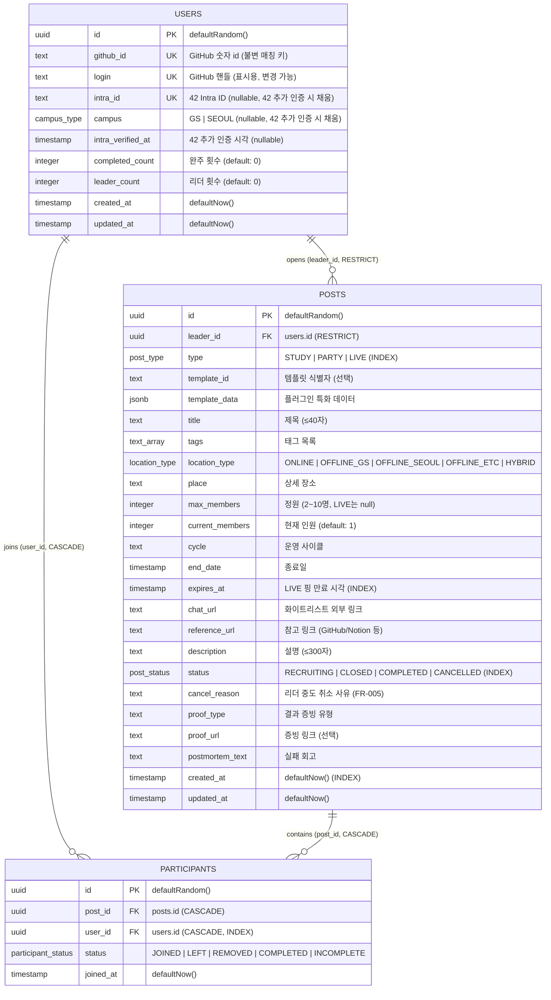

# [TRD] 모두의 42 (Modu-42) — 기술 요구사항 명세서

* **문서 버전:** v2.1 (Phased Milestone & Production-Ready)
* **대상:** 프로덕션 서비스 운영 수준 아키텍처 및 구현 명세
* **개발 방법론:** Spec-Driven Development (`speckit`) + Vitest 기반 TDD
* **연관 문서:** [requirement.md](./requirement.md) (요구사항 정의서), [speckit-guide.md](./speckit-guide.md) (speckit 가이드), [plan.md](./plan.md) (기획서), [prd.md](./prd.md) (기능 명세서)

---

## 1. 기술 스택 (Tech Stack)

| 영역 | 선택 기술 | 선정 이유 및 역할 |
| :--- | :--- | :--- |
| **Frontend** | Next.js 14 (App Router) + TypeScript + Tailwind CSS | React Server Components(RSC)를 통한 초기 렌더링 최적화 및 SEO |
| **Backend** | Next.js Route Handlers (`app/api/**`) | Vercel Serverless Function 기반 경량 API 레이어 |
| **ORM** | **Drizzle ORM** + `drizzle-kit` | 제로 런타임 오버헤드, 엄격한 TypeScript 타입 추론, 원자적 트랜잭션(`db.transaction`) |
| **Database** | **Supabase (PostgreSQL)** | 원격 개발/상용 PostgreSQL 인스턴스, Connection Pooling, 강력한 RLS |
| **Realtime** | **Supabase Realtime Engine** | PostgreSQL WAL(Write-Ahead Log) 기반 실시간 브로드캐스트 (LIVE 핑, 실시간 참여자 수) |
| **Authentication** | Phase 0~3: 로컬 Mock 쿠키 세션<br>Phase 4: GitHub OAuth 2.0 Authorization Code + HMAC-SHA256 서명 세션 쿠키 | 개발 단계 속도 최적화, Route Handler 직접 토큰 교환 및 `GITHUB_CLIENT_SECRET` 파생 키 기반 30일 서명 쿠키로 외부 의존성 제거 |
| **Testing** | **Vitest** | 초고속 단위/통합 테스트, 실제 DB 트랜잭션 롤백 기반 동시성/비즈니스 로직 검증 |
| **Workflow** | **speckit (Spec Kit)** | `specify` → `plan` → `tasks` → `implement` 4단계 루프 기반 사양 주도 개발 |
| **CI/CD & Deploy** | GitHub Actions + Vercel | PR 자동 린트/타입/스키마 정합성 검증(테스트는 로컬 게이트, §6.3), Vercel 자동 프리뷰/프로덕션 배포 |

---

## 2. 인증 및 인가 아키텍처 (Auth Architecture)

### 2.1 [Phase 0~3] 개발 환경 Mock 인증 아키텍처
GitHub OAuth 연동 전까지 빠르고 독립적인 TDD 및 기능 검증을 위해 로컬 Mock 인증 체계를 운영합니다.

**`FR-027` 구현 후 선택 UI는 개발자 콘솔의 인증 섹션(`src/components/dev/DevConsolePanel.tsx`)이고 `MockAuthModal.tsx`는 삭제됐습니다.** 엔드포인트와 쿠키는 그대로이며 게이트만 콘솔로 바뀌었습니다 (§2.4).

```text
[개발자 UI] ──(클릭)──> [DevConsolePanel 인증 섹션]
                             │
                             ▼
                    POST /api/mock-auth
              (쿠키: modoo42_mock_user 주입)
                             │
                             ▼
                 서버 공통: getCurrentUser()
       (쿠키 파싱 -> DB users 테이블 매핑/Upsert)
```

1. **Mock 페르소나 정의 (4종):** 각 페르소나는 `github_id`(`mock:<키>`)와 `login`(키와 동일)을 가지며, Upsert 충돌 기준은 `github_id`입니다. `intra_id`와 `intra_verified_at`은 페르소나가 채우지 않습니다 (`FR-016`, §1.3 보류).
   - `gs_leader`: 경산 캠퍼스 리더 (`campus: 'GS'`, 기존 작성 글 다수 보유)
   - `gs_member`: 경산 캠퍼스 일반 참여자 (`campus: 'GS'`)
   - `seoul_member`: 서울 캠퍼스 멤버 (`campus: 'SEOUL'`)
   - `github_only`: GitHub 인증만 한 유저 (`campus: null`). 캠퍼스 뱃지 미렌더와 LIVE 핑 `OFFLINE_ETC` 파생을 검증합니다.
   - `guest`: 로그아웃 상태

   페르소나 정의는 `src/lib/personas.ts` 한 곳에 둡니다. `src/lib/auth.ts`(세션 해석)와 `src/components/dev/DevConsolePanel.tsx`(선택 UI)가 같은 정의를 읽습니다 — 클라이언트 컴포넌트가 `@/db`를 import할 수 없으므로 정의 모듈을 분리합니다.
2. **세션 쿠키 발급:** `/api/mock-auth` 호출 시 `modoo42_mock_user` 쿠키에 선택한 페르소나 식별자를 기록.
3. **공통 세션 추상화 (`src/lib/auth.ts`):**
   - `getCurrentUser()` 함수 제공.
   - 개발 환경(`NODE_ENV === 'development'`): `modoo42_session` 실제 세션 쿠키가 있으면 우선 해석하고, 없으면 `modoo42_mock_user` 쿠키를 읽어 `users` 테이블의 Mock 레코드 반환.
   - 상용 배포 환경: 자동으로 Mock API 및 UI 모달 비활성화, `modoo42_session` 서명 쿠키 검증으로 동작.

### 2.2 [Phase 4] 프로덕션 GitHub OAuth 2.0 플로우

1. **로그인 시작 (`GET /api/auth/github`):** 유저 `[GitHub 계정으로 로그인]` 클릭 → GitHub 인가 엔드포인트(`https://github.com/login/oauth/authorize`) 리다이렉트. `scope=read:user`, `state` 난수 발급 후 단기 `HttpOnly` 쿠키(`modoo42_oauth_state`, `Max-Age=600`)에 보관.
   - **PKCE를 쓰지 않습니다.** GitHub OAuth App은 PKCE(`code_challenge`)를 지원하지 않습니다. CSRF 방어는 `state` 검증이 담당하고, `client_secret`은 서버에만 둡니다.
2. **토큰 교환 (`GET /api/auth/callback`):** 콜백에서 `code`와 `state` 수신 → 쿠키의 `state`와 **상수 시간 비교(`timingSafeEqual`)**하여 불일치 시 즉시 거부(`state` 쿠키는 1회용으로 즉시 파기) → `https://github.com/login/oauth/access_token`으로 `access_token` 교환.
3. **프로필 조회:** `GET https://api.github.com/user` 호출하여 `id`(불변 숫자 식별자, 문자열 변환해 `github_id`로 저장)와 `login`(표시용 핸들) 수집.
   - **`avatar_url`은 수집하지 않습니다** (`CLAUDE.md` §7.2). UI는 `login` 앞 2자리 이니셜 뱃지를 씁니다.
   - **캠퍼스는 이 단계에서 결정되지 않습니다.** `users.campus`는 `null`로 남고, 42 Intra 추가 인증(`requirement.md` §1.3 보류)에서만 채워집니다.
4. **계정 동기화 (핸들 변경 충돌 방어 포함):** Drizzle ORM 트랜잭션으로 `users` 테이블에 Upsert. **충돌 기준 컬럼은 `github_id`입니다.** `login`은 유저가 GitHub에서 변경할 수 있으므로 매칭 키로 쓰지 않고, Upsert 시 최신 값으로 갱신합니다. 만약 다른 `github_id` 행이 동일한 `login`을 점유 중이면(이전 주인이 GitHub에서 핸들을 바꾼 뒤 재로그인하지 않은 경우), 그 구 행의 `login`을 `stale:<github_id>`로 먼저 비켜준 뒤 현재 유저를 Upsert합니다.
5. **장기 세션 쿠키 발급:** `GITHUB_CLIENT_SECRET`에서 파생한 키로 HMAC-SHA256 서명한 토큰(`userId.exp.sig`)을 `modoo42_session` 쿠키에 기록합니다 (`Max-Age=2592000` 30일, `HttpOnly`, `Secure`(production), `SameSite=Lax`, `Path=/`). 추가 환경변수 없이 기존 `GITHUB_CLIENT_SECRET`만으로 서명·검증합니다.
6. **Zero-Click 라우팅:**
   - **미인증 유저:** 루트(`/`)는 `/login`으로 리다이렉트하며, `/dashboard`·`/create`·`/profile`은 피드를 노출하지 않고 로그인 안내(`LoginRequired`)를 렌더합니다. 조회·쓰기 Route Handler(`/api/posts` 등)도 401/403으로 거절합니다 (`GET /api/list` CLI 엔드포인트 제외).
   - **인증 유저:** 랜딩(`/login`) 또는 루트(`/`) 접근 시 0초 만에 `/dashboard`로 직행.
   - **DB 보안:** Supabase RLS 및 Route Handler에서 `session.user.id == post.leader_id` 이중 검증.

### 2.3 [§1.3 보류] 42 Intra 추가 인증

GitHub 인증을 1차로 두고, 42 Intra OAuth를 선택적 2차 인증으로 연결합니다. 착수 시점은 미정이며(`requirement.md` §1.3), 범위는 `users.intra_id`·`users.campus`·`users.intra_verified_at` 채우기와 캠퍼스 뱃지 표출까지입니다. 컬럼은 `FR-016`에서 nullable로 미리 만들어 두므로 추가 마이그레이션 없이 착수할 수 있습니다.

### 2.4 [Phase 4] 개발자 콘솔 — 시각 주입 및 샌드박스 격리 (`FR-027`·`FR-028`)

시각에 걸린 요구사항(`FR-008` 판정창, `FR-011` LIVE 만료와 1일 1회, `FR-018` Grace Period, `FR-020` 파티 만료)을 달이 바뀌기를 기다리지 않고 검증하기 위한 개발 전용 하네스입니다.

```text
[/login 화면]
    │
    ├─(비밀번호)──> POST /api/dev/console
    │                 DEV_CONSOLE_PASSWORD 미설정 환경 -> 404
    │                 timingSafeEqual 검증 -> modoo42_dev_console 서명 쿠키
    │                 세션 표식 없음/TTL 경과 -> dev_sandbox 초기화 + 스냅샷
    │                 표식 유효 -> 기존 샌드박스 합류
    ▼
[개발자 콘솔 패널]  인증(페르소나) · 시계(절대 시각 입력) · 시나리오 프리셋
    │
    ├─> POST /api/mock-auth      (modoo42_mock_user)
    └─> POST /api/dev/clock      (modoo42_dev_clock: offsetMs 정수 1개)
                                      │
                                      ▼
                        src/lib/clock.ts  serverNow() / realNow()
                                      │
                      RSC·Route Handler가 now를 도메인 함수에 주입
```

1. **시각 소유권은 `src/lib/clock.ts` 한 모듈입니다.**
   - `serverNow()`는 `modoo42_dev_clock`의 `offsetMs`를 더해 반환합니다. 요청 스코프 전용입니다.
   - `realNow()`는 오프셋을 무시합니다. `src/lib/session.ts`가 이것을 씁니다 — 세션 30일 만료가 dev 시계를 따라가면 미래 점프 시 콘솔에서 쫓겨납니다.
   - **도메인 레이어는 쿠키를 읽지 않습니다.** `cookies()`가 요청 스코프 밖에서 던지므로, 도메인이 읽으면 Vitest와 `FR-018` Cron이 깨집니다. `src/lib/posts.ts`·`leader-actions.ts`는 지금처럼 `now`를 명시 인자로만 받고 **기본값 `new Date()`를 제거**합니다. 누락을 타입으로 잡기 위함입니다.
   - `createPost`는 현재 `now`를 받지 않고 내부에서 `computeStudyEndDate(new Date())`를 호출합니다. 여기서 `now` 인자를 신설합니다.
   - **`created_at`·`joined_at`도 유효 시각으로 명시 삽입합니다** (2026-10-19 승인). `src/db/schema.ts:27`·`60`·`72`의 `defaultNow()`에 맡기면 과거를 볼 수는 있어도 과거에 쓸 수는 없고, 과거 사이클 스터디가 없으면 아카이브·명예의 전당을 검증할 수 없습니다. 컬럼 기본값은 유지하므로 마이그레이션이 없고, `created_at` 2곳·`joined_at` 2곳(+재참여 갱신 1곳)·도메인 `updated_at` 4곳이 값을 넘깁니다. 대가는 피드 정렬(`created_at`)이 dev 시계에 따라 흔들리는 것입니다. 실제 시각을 유지하는 자리는 `session.ts`의 만료 검증과 `src/lib/auth.ts:70`·`77`의 로그인 갱신뿐입니다.
   - **상용 차단은 이 모듈 안에서 한 번만** 합니다. 오프셋을 반영하는 조건은 `DEV_CONSOLE_PASSWORD` 설정과 유효한 `modoo42_dev_console` 서명 쿠키 **둘 다**이며, 하나라도 없으면 오프셋 쿠키를 읽지 않습니다. 쿠키 위조로 판정창·LIVE 1일 1회·파티 만료를 우회할 수 없습니다.
2. **시계 모델은 오프셋 1개입니다.** 패널 입력은 절대 시각(KST)이고, 제출 시 `입력 − 실제 now`를 정수 ms로 환산해 쿠키에 담습니다. 음수(과거)를 허용하고 범위 제한이 없습니다. 점프 후에도 시계가 흐르므로 LIVE 핑 카운트다운(`src/lib/display.ts` `remainingLabel`)과 만료 전이가 그대로 재현됩니다. 대가는 탭을 오래 열어 두면 KST 날짜 경계를 저절로 넘는 것이고, 프리셋 재클릭으로 되돌립니다. 고정(freeze) 모드는 도입하지 않습니다.
3. **클라이언트도 같은 오프셋을 받습니다.** `LivePingBoard`의 1초 인터벌과 `LeaderActions`가 자체 `new Date()`로 판단하면 서버와 어긋납니다. 오프셋을 prop 또는 Context로 내려 `new Date(Date.now() + offsetMs)`로 계산합니다.
4. **쓰기는 `dev_sandbox` 스키마로 격리합니다.** `src/lib/posts.ts`의 모든 도메인 함수가 이미 `database: Database = defaultDb`를 받으므로, 라우트·RSC에서 핸들만 고릅니다.
   - **격리 범위는 브라우저 단위 앱 전체입니다** (2026-10-19 사용자 결정). 콘솔 세션 쿠키가 유효한 동안 그 브라우저의 모든 읽기·쓰기가 샌드박스를 봅니다. 콘솔 화면만 격리하면 샌드박스에 쓴 글이 피드·상세에 보이지 않아 `FR-008`·`FR-018`·`FR-020` 검증이 성립하지 않습니다. `src/lib/auth.ts`가 `defaultDb`를 직접 쓰므로 현재 유저 해석도 함께 샌드박스로 돌립니다 — 스냅샷이 행 식별자를 보존하므로 `public`에서 발급된 세션이 샌드박스에서도 같은 유저로 해석됩니다. 쿠키 삭제가 운영 복귀 경로이고, 쿠키가 없는 브라우저는 영향을 받지 않습니다. 샌드박스 핸들은 `postgres(connectionString, { connection: { search_path: 'dev_sandbox' } })`로 만든 두 번째 drizzle 인스턴스입니다.
   - **같은 Supabase 프로젝트 안의 두 번째 스키마입니다.** 새 자원이 없어 비용이 0입니다. 별도 Supabase 프로젝트와 별도 Vercel 프로젝트는 채택하지 않았습니다.
   - `drizzle-kit`은 `public`만 관리합니다. `dev_sandbox`는 `drizzle/`의 SQL을 `search_path=dev_sandbox`로 재생해 만들고, 스키마 변경 때마다 재생이 필요합니다. 열거형도 스키마 스코프라 함께 생성됩니다.
   - **세션 중에는 물리적으로 저장됩니다.** 참여 트랜잭션이 `.for('update')` 행 잠금을 쓰고(§4.1) RSC와 Route Handler가 별개 요청이므로, 메모리 보관으로는 `NFR-001`이 성립하지 않습니다. "저장되지 않는다"는 **세션 사이**에 대해서만 성립합니다.
5. **진입 시 초기화 + 스냅샷.** `dev_sandbox`를 비우고 `public`에서 복사합니다.
   - 삭제 순서는 `participants` → `posts` → `users`입니다 (`posts.leader_id`가 `onDelete: 'restrict'`).
   - **`chat_url`은 플랫폼 보존 더미 링크로 치환해 복사합니다.** 참여자 전용 값이고 마이그레이션 `0003`으로 `anon` 권한까지 끊어 둔 실제 초대 링크입니다(§5-2). 콘솔 비밀번호 보유자가 전체 오픈채팅방 링크를 열람하게 두지 않습니다. **전건 `NULL`은 쓰지 않습니다** — `chatPlatform`이 컬럼이 아니라 `chat_url`에서 파생되기 때문이다(`src/lib/posts.ts:297`). 전건 `NULL`로 만들면 플랫폼 배지가 사라지고 참여 확인 카피가 모든 글을 오프라인 전용으로 본다, 콘솔이 검증해야 할 참여 플로우가 운영과 달라집니다. 값과 SQL은 `specs/010-dev-console/contracts/sandbox-isolation.md` S4가 SSOT입니다.
   - 비우지 않고 재복사하면 `users.github_id`·`users.login` 유일 제약에 걸립니다. 즉 "비우기 + 복사"는 한 묶음입니다.
   - **파괴적 문장은 스키마를 수식합니다.** `TRUNCATE dev_sandbox.participants, dev_sandbox.posts, dev_sandbox.users`. `search_path`에 의존하면 `public`이 날아갈 수 있고 복구 수단이 없으므로, 실행 전에 대상 스키마 이름을 상수와 대조해 단정합니다.
   - **세션 표식**(시작 시각 + TTL) 행이 유효하면 초기화를 건너뛰고 합류합니다. `NFR-004`의 2창 검증(`specs/006-dashboard-realtime/quickstart.md` §4)에서 시크릿 창의 재진입이 먼저 쓰던 창을 지우는 것을 막습니다.
   - 스키마가 하나이므로 **동시 샌드박스는 1개**입니다. 운영자 2명 이상은 지원 범위 밖입니다.
6. **게이트는 `DEV_CONSOLE_PASSWORD` 환경변수 유무입니다.** 설정된 환경에서만 콘솔 라우트를 등록하고, Vercel Production 스코프에는 설정하지 않습니다. 운영 도메인에는 라우트가 존재하지 않고, Preview·Development 스코프에서만 열립니다. 비밀번호 비교는 `timingSafeEqual`, admin 세션은 `modoo42_dev_console` HMAC 서명 쿠키입니다. 평문 플래그 쿠키는 비밀번호를 무의미하게 만들므로 쓰지 않습니다.
   - **게이트는 이것 하나입니다** (2026-10-19 사용자 결정). `src/components/MockAuthModal.tsx`를 삭제하고 `src/lib/auth.ts`의 `isMockAuthEnabled()`가 쓰던 `NODE_ENV` 기준을 콘솔 게이트로 바꿉니다. 페르소나 전환도 콘솔 세션 뒤에 있습니다. 게이트가 둘이면 "상용에 열리지 않는다"를 두 경로에서 지켜야 하고, 그것이 이 기능의 유일한 보안 속성입니다. 대가는 로컬에서도 `DEV_CONSOLE_PASSWORD` 설정과 1회 로그인이 필요한 것이며, 콘솔 세션 쿠키가 유지되므로 매 요청은 아닙니다.
7. **Realtime도 샌드박스를 봅니다.** `ALTER PUBLICATION supabase_realtime ADD TABLE dev_sandbox.posts`를 걸고, `0003_revoke_anon_chat_url.sql`의 컬럼 단위 SELECT 권한을 `dev_sandbox.posts`에도 복제합니다. 권한을 복제하지 않으면 샌드박스 쪽에서 `chat_url`이 구독자에게 샙니다(§5-2). 클라이언트는 `postgres_changes` 구독에 `schema: 'dev_sandbox'`를 넘깁니다.
8. **DB는 되돌아가지 않습니다.** 시계만 과거로 갑니다. 상태 머신은 전진 전용이고 `COMPLETED`·`CANCELLED`가 최종이므로(`CLAUDE.md` §6.4), 판정 후 종료월 전으로 돌아가면 "사이클 중인데 이미 `COMPLETED`"라는 조합이 나옵니다. 데이터 손상은 아니며, 되돌리려면 그 글을 다시 만듭니다. 상태 롤백 기능은 만들지 않습니다.

---

## 3. 데이터베이스 스키마 및 ERD 명세 (Drizzle ORM)

### 3.1 ERD 다이어그램 (Mermaid)



### 3.2 Drizzle ORM 스키마 코드 (`src/db/schema.ts`)

```typescript
// src/db/schema.ts
import { pgTable, uuid, text, timestamp, integer, pgEnum, jsonb, uniqueIndex, index } from 'drizzle-orm/pg-core';
import { relations } from 'drizzle-orm';

export const campusEnum = pgEnum('campus_type', ['GS', 'SEOUL']);
export const postTypeEnum = pgEnum('post_type', ['STUDY', 'PARTY', 'LIVE']);
export const postStatusEnum = pgEnum('post_status', ['RECRUITING', 'CLOSED', 'COMPLETED', 'CANCELLED']);
// OFFLINE_ETC: 캠퍼스 미인증 유저의 LIVE 핑 (FR-016). PostgreSQL 열거형 값 추가는 전진 전용이라 롤백할 수 없다.
export const locationTypeEnum = pgEnum('location_type', ['ONLINE', 'OFFLINE_GS', 'OFFLINE_SEOUL', 'OFFLINE_ETC', 'HYBRID']);
export const participantStatusEnum = pgEnum('participant_status', ['JOINED', 'LEFT', 'REMOVED', 'COMPLETED', 'INCOMPLETE']);

export const users = pgTable('users', {
  id: uuid('id').defaultRandom().primaryKey(),

  // GitHub OAuth 1차 인증 (FR-015). github_id는 불변 매칭 키, login은 표시용이며 유저가 변경할 수 있다.
  githubId: text('github_id').unique().notNull(),
  login: text('login').unique().notNull(),

  // 42 Intra 추가 인증 전까지 null이다 (requirement.md §1.3 보류).
  intraId: text('intra_id').unique(),
  campus: campusEnum('campus'),
  intraVerifiedAt: timestamp('intra_verified_at', { withTimezone: true }),

  completedCount: integer('completed_count').default(0).notNull(),
  leaderCount: integer('leader_count').default(0).notNull(),
  createdAt: timestamp('created_at', { withTimezone: true }).defaultNow().notNull(),
  updatedAt: timestamp('updated_at', { withTimezone: true }).defaultNow().notNull(),
});

export const posts = pgTable('posts', {
  id: uuid('id').defaultRandom().primaryKey(),
  leaderId: uuid('leader_id').references(() => users.id, { onDelete: 'restrict' }).notNull(),
  type: postTypeEnum('type').notNull(),
  
  // [책장/플러그인 아키텍처] 템플릿 식별자 (예: 'cote', 'commit', 'reading', 'duolingo', 'music', 'custom')
  templateId: text('template_id'),
  
  // [책장/플러그인 아키텍처] 템플릿 전용 특화 데이터 (JSONB, Phase 2 고도화)
  // - 새로운 스터디 유형 추가 시 DB 스키마 수정 없이 TypeScript 정의 PR만으로 확장
  templateData: jsonb('template_data').$type<Record<string, unknown>>(),

  title: text('title').notNull(),
  tags: text('tags').array().notNull(),
  locationType: locationTypeEnum('location_type').notNull(),
  place: text('place'), // 온/오프라인 상세 장소 또는 클러스터 좌석
  maxMembers: integer('max_members'), // 스터디/파티: 2~10명(Zod 검증), LIVE 핑: 미사용(null)
  currentMembers: integer('current_members').default(1).notNull(), // 리더 포함 1명 시작
  cycle: text('cycle'),
  endDate: timestamp('end_date', { withTimezone: true }),
  expiresAt: timestamp('expires_at', { withTimezone: true }), // LIVE 핑 만료 시각
  chatUrl: text('chat_url'), // 스터디/파티: 화이트리스트 URL. 온라인·HYBRID는 필수, 오프라인 전용은 선택(Zod superRefine). LIVE 핑: 미사용(null)
  referenceUrl: text('reference_url'), // 참고 링크 (GitHub/Notion 등)
  description: text('description'),
  status: postStatusEnum('status').default('RECRUITING').notNull(),
  cancelReason: text('cancel_reason'), // 리더 중도 취소 사유 (FR-005). 취소 시에만 채워진다.
  proofType: text('proof_type'),
  proofUrl: text('proof_url'), // 선택 입력 (없어도 완주 가능)
  postmortemText: text('postmortem_text'), // 실패 회고
  createdAt: timestamp('created_at', { withTimezone: true }).defaultNow().notNull(),
  updatedAt: timestamp('updated_at', { withTimezone: true }).defaultNow().notNull(),
}, (table) => [
  index('posts_feed_idx').on(table.type, table.status, table.createdAt),
  index('posts_live_ping_idx').on(table.type, table.status, table.expiresAt),
]);

export const participants = pgTable('participants', {
  id: uuid('id').defaultRandom().primaryKey(),
  postId: uuid('post_id').references(() => posts.id, { onDelete: 'cascade' }).notNull(),
  userId: uuid('user_id').references(() => users.id, { onDelete: 'cascade' }).notNull(),
  status: participantStatusEnum('status').default('JOINED').notNull(),
  joinedAt: timestamp('joined_at', { withTimezone: true }).defaultNow().notNull(),
}, (table) => [
  uniqueIndex('participants_post_user_idx').on(table.postId, table.userId),
  index('participants_user_id_idx').on(table.userId),
]);

export const usersRelations = relations(users, ({ many }) => ({
  posts: many(posts),
  participations: many(participants),
}));

export const postsRelations = relations(posts, ({ one, many }) => ({
  leader: one(users, { fields: [posts.leaderId], references: [users.id] }),
  participants: many(participants),
}));

export const participantsRelations = relations(participants, ({ one }) => ({
  post: one(posts, { fields: [participants.postId], references: [posts.id] }),
  user: one(users, { fields: [participants.userId], references: [users.id] }),
}));
```

### 3.3 모듈형 템플릿 레지스트리 (Bookcase / Plugin Pattern)

* **원칙:** 플랫폼은 스터디 수명주기(모집·참여·완주)만 제공하고, 세부 스터디 유형은 템플릿 플러그인으로 분리.
* **확장 방식:** 신규 템플릿 추가 시 DB 스키마 수정 없이 `src/templates/registry.ts`에 정의 파일 1개만 PR 제출.

```typescript
// src/templates/types.ts
import { z } from 'zod';

export interface StudyTemplate<TData = Record<string, unknown>> {
  id: string;
  title: string;
  description: string;
  defaultTags: string[];
  defaultProofType: string;
  dataSchema?: z.ZodType<TData>;
  CustomFormField?: React.ComponentType<{
    value: TData;
    onChange: (val: TData) => void;
  }>;
}
```

---

## 4. 핵심 트랜잭션 및 API 명세

| Method | Endpoint | 설명 | 인증/인가 | 대응 Phase |
| :--- | :--- | :--- | :--- | :--- |
| POST | `/api/mock-auth` | [로컬 전용] Mock 페르소나 쿠키 세팅 | 불필요 (개발 모드) | Phase 0 |
| GET | `/api/auth/github` | GitHub 인가 엔드포인트로 302 리다이렉트 (`state` 난수 발급 및 쿠키 보관) | 불필요 | Phase 4 |
| GET | `/api/auth/callback` | `code`·`state` 수신 → `state` 검증 → 토큰 교환 → `users` Upsert(`github_id` 충돌 기준) → 30일 세션 쿠키 발급 → `/dashboard` 리다이렉트 | 불필요 | Phase 4 |
| POST | `/api/auth/logout` | 세션 쿠키 파기 후 `/login` 리다이렉트 | 필요 | Phase 4 |
| GET | `/api/posts` | 대시보드 리스트 조회 (필터: `type`, `status`, `sort`) | 필요 | Phase 1 & 3 |
| GET | `/api/posts/:id` | 게시글 상세 조회 (참여자 목록 포함) | 필요 | Phase 1 |
| POST | `/api/posts` | 스터디/단기 파티 개설 (개설자 participants 자동 등록 및 `currentMembers: 1` 초기화) / LIVE 핑 개설 (`{ type: 'LIVE', text, place, durationMinutes: 30\|60\|120\|180 }`, KST 자정 00:00 기준 1일 1회 제한, `max_members`·`chat_url`·`tags` 미사용) | 필요 | Phase 1 & 2 |
| PUT | `/api/posts/:id` | 리더의 게시글 수정 (제목, 설명, 오픈채팅 링크, 장소) | 리더 본인 | Phase 1 |
| POST | `/api/posts/:id/join` | 원클릭 참여 및 `FOR UPDATE` 동시성 제어 (멱등성 보장) | 필요 | Phase 1 |
| POST | `/api/posts/:id/cancel` | 리더의 스터디 중도 취소 (`status = 'CANCELLED'`) | 리더 본인 | Phase 1 |
| POST | `/api/posts/:id/status` | 리더의 수동 마감/재모집 토글 (`RECRUITING ↔ CLOSED`) | 리더 본인 | Phase 1 |
| POST | `/api/posts/:id/complete-ping` | LIVE 핑 작성자의 조기 완료 (`status = 'CLOSED'` 전이, 전광판 즉시 소멸, 이미 `CLOSED`면 멱등 200) | 작성자 본인 | Phase 2 |
| POST | `/api/posts/:id/complete` | 완주 벌크 판정 (팀원 판정 필수, 리더 본인 자동 가산, 증빙 선택, 리더/완주자 카운트 원자적 가산) | 리더 본인 | Phase 2 |
| POST | `/api/posts/:id/postmortem` | 실패 회고 작성 (기한 도과 미판정 스터디 대상 포함) | 리더 본인 | Phase 2 |
| GET | `/api/list` | 터미널 CLI 조회용 엔드포인트 (`curl modoo42.com/api/list`). `?format=ansi`(기본)·`plain`·`json`. 모집 중 스터디·파티와 활성 LIVE 핑, 작성자 `login`·장소 포함, `chat_url` 미포함 | 불필요 | Phase 2 |
| GET | `/api/hall-of-fame` | 🏆명예의 전당(`kind=completed`, 기본) / 🪦Post-mortem(`kind=postmortem`) 목록. 정규 스터디 전용, `chat_url` 미포함 | 필요 | Phase 2 |
| GET | `/api/templates` | 템플릿 프리셋 목록 (ID·이름·기본 설명·기본 태그) | 필요 | Phase 2 |
| GET | `/api/leaderboard` | 성실 멤버 상위 랭킹 (완주 횟수 → 리더 횟수 → `login` 순 1~5위) | 필요 | Phase 2 |

### 4.1 원자적 참여 트랜잭션 (`POST /api/posts/:id/join`)
Drizzle ORM `db.transaction()`과 Postgres 행 잠금(`FOR UPDATE`)을 적용하여 동시성 레이스를 완벽히 차단합니다.

```typescript
export async function joinStudy(postId: string, userId: string) {
  return await db.transaction(async (tx) => {
    // 1. 게시글 행 잠금 (Row Lock)
    const [post] = await tx
      .select()
      .from(posts)
      .where(eq(posts.id, postId))
      .for('update');

    if (!post) throw new AppError('NOT_FOUND', '게시글이 존재하지 않습니다.');
    if (post.status !== 'RECRUITING') throw new AppError('CLOSED', '모집이 마감된 스터디입니다.');

    // 2. 기존 참여 여부 확인 (멱등성 보장)
    const [existing] = await tx
      .select()
      .from(participants)
      .where(and(eq(participants.postId, postId), eq(participants.userId, userId)));

    if (existing && existing.status === 'JOINED') {
      return { chatUrl: post.chatUrl, reJoined: true };
    }

    // 3. 정원 초과 검증 (NFR-001)
    if (post.maxMembers && post.currentMembers >= post.maxMembers) {
      throw new AppError('FULL', '정원이 초과되었습니다.');
    }

    // 4. 참여 기록 추가
    if (existing) {
      await tx
        .update(participants)
        .set({ status: 'JOINED', joinedAt: new Date() })
        .where(eq(participants.id, existing.id));
    } else {
      await tx.insert(participants).values({ postId, userId, status: 'JOINED' });
    }

    // 5. 정원 카운트 증가 및 마감 자동 전이
    const nextCount = post.currentMembers + 1;
    const isClosed = post.maxMembers ? nextCount >= post.maxMembers : false;

    await tx
      .update(posts)
      .set({
        currentMembers: nextCount,
        status: isClosed ? 'CLOSED' : 'RECRUITING',
      })
      .where(eq(posts.id, postId));

    return { chatUrl: post.chatUrl, reJoined: false };
  });
}
```

### 4.2 완주 벌크 판정 트랜잭션 (`POST /api/posts/:id/complete`)
리더의 벌크 판정 결과에 따라 완주 멤버의 `completedCount`와 리더의 `leaderCount`를 단일 트랜잭션으로 원자적 가산합니다.
참여(§4.1)와 같이 게시글 행을 `FOR UPDATE`로 먼저 잠가, 동시 판정 2건의 이중 가산과 판정 중 신규 참여 경합을 막습니다.
아래 코드는 핵심 흐름만 보인다. 실제 구현은 추가로 `type === 'STUDY'`, 판정 창(사이클 종료월 15일 ~ 익월 10일 KST), `postmortem_text` 부재, 판정 목록 = 리더 제외 `JOINED` 참여자 전원, 완주 멤버 ≥1명을 검증하고, 리더 참여 행을 `COMPLETED`로 갱신한다 (`specs/003-completion-lifecycle/contracts/posts-complete.md`).

```typescript
export async function completeStudy(
  postId: string,
  leaderId: string,
  evaluations: { userId: string; isCompleted: boolean }[],
  proofUrl?: string
) {
  return await db.transaction(async (tx) => {
    // 1. 게시글 행 잠금 (Row Lock) 및 리더 권한 검증
    const [post] = await tx.select().from(posts).where(eq(posts.id, postId)).for('update');
    if (!post) throw new AppError('NOT_FOUND', '게시글이 존재하지 않습니다.');
    if (post.leaderId !== leaderId) throw new AppError('FORBIDDEN', '리더만 판정할 수 있습니다.');
    if (post.status === 'COMPLETED' || post.status === 'CANCELLED') {
      throw new AppError('BAD_REQUEST', '이미 종료되었거나 취소된 스터디입니다.');
    }

    // 2. 참여자 상태 업데이트 및 완주자 카운트 가산
    for (const ev of evaluations) {
      const status = ev.isCompleted ? 'COMPLETED' : 'INCOMPLETE';
      await tx
        .update(participants)
        .set({ status })
        .where(and(eq(participants.postId, postId), eq(participants.userId, ev.userId)));

      if (ev.isCompleted) {
        await tx
          .update(users)
          .set({ completedCount: sql`${users.completedCount} + 1` })
          .where(eq(users.id, ev.userId));
      }
    }

    // 3. 리더 leaderCount 가산
    await tx
      .update(users)
      .set({ leaderCount: sql`${users.leaderCount} + 1` })
      .where(eq(users.id, leaderId));

    // 4. 게시글 상태 COMPLETED 전이
    await tx
      .update(posts)
      .set({
        status: 'COMPLETED',
        proofUrl: proofUrl || null,
      })
      .where(eq(posts.id, postId));

    return { success: true };
  });
}
```

---

## 5. 실시간 동기화 (Supabase Realtime)

1. **테이블 복제 설정 (WAL):**

   ```sql
   alter publication supabase_realtime add table posts
     (id, type, status, current_members, max_members, expires_at, created_at, updated_at);
   ```

   - 공개 컬럼은 `NFR-004`가 요구하는 최소 집합입니다. 신규 LIVE 핑의 제목·태그·위치는 `INSERT` 이벤트를 받은 뒤 `GET /api/posts`로 다시 조회해 채웁니다.
   - 컬럼 구성을 바꿀 때는 `alter publication supabase_realtime set table posts (...)`로 교체합니다.
   - 복제 식별자는 기본 키 `posts.id`를 쓰므로 `replica identity` 추가 설정이 필요 없습니다.
2. **페이로드에서 `chat_url`을 막는 방어선은 컬럼 단위 SELECT 권한입니다 (필수):**

   ```sql
   -- drizzle/0003_revoke_anon_chat_url.sql
   revoke select on table posts from anon, authenticated;
   grant select (id, type, max_members, current_members, expires_at, status, created_at, updated_at)
     on table posts to anon, authenticated;
   ```

   - Realtime 구독은 브라우저가 `NEXT_PUBLIC_SUPABASE_ANON_KEY`로 직접 붙으므로 Route Handler의 `chat_url` 마스킹(§4, 헌법 V)을 거치지 않습니다. anon 키는 설계상 공개 값이라 숨길 수 없습니다.
   - **publication 컬럼 목록만으로는 막히지 않습니다.** `006` 브랜치에서 실측한 결과(2026-10-18), 컬럼 목록을 지정한 publication에 등록된 상태에서도 anon 구독자에게 `posts`의 **모든 컬럼**이 전달됐고 `chat_url`도 포함됐습니다. Supabase Realtime의 `postgres_changes`는 복제 슬롯을 `wal2json` 플러그인으로 읽기 때문에(`pg_replication_slots.plugin = 'wal2json'`) publication의 컬럼 목록이 적용되지 않습니다. 실제 필터는 `realtime.apply_rls`가 보는 컬럼 단위 SELECT 권한입니다.
   - PostgreSQL은 테이블 단위 SELECT가 남아 있으면 컬럼 단위 `revoke`가 효과가 없습니다. 테이블 권한을 걷어낸 뒤 공개 컬럼만 다시 부여해야 합니다.
   - 권한을 모두 걷어내면 `apply_rls`가 레코드를 통째로 버려 이벤트가 오지 않습니다. 부여 목록은 publication 컬럼 목록과 같게 유지합니다.
   - 서버(Route Handler·Drizzle·마이그레이션)는 `postgres` 역할로 붙으므로 이 변경에 영향을 받지 않습니다. 반대로 `anon` 역할의 PostgREST(`/rest/v1/posts`)로 `select=*`를 호출하면 거절됩니다 — `posts`는 Route Handler로만 조회합니다.
   - 검증은 `specs/006-dashboard-realtime/quickstart.md` §4의 WebSocket 프레임 확인입니다. 컬럼을 추가·변경할 때마다 다시 확인합니다.
3. **클라이언트 구독 패턴 (Next.js):**
   - `useEffect` 또는 커스텀 훅(`useRealtimePosts`)에서 `supabase.channel('posts-channel')` 구독.
   - `UPDATE` 이벤트: `currentMembers`, `status` 변경 시 대시보드 카드 카운트 및 마감 상태 즉각 갱신.
   - `INSERT` 이벤트: 신규 LIVE 핑 감지 시 전광판 상단에 즉각 prepend. payload에 제목·위치가 없으므로 서버 조회로 보강합니다.
   - 1초 이내 무새로고침 반영 (`NFR-004`).

---

## 6. 테스트, CI/CD 및 speckit SDD 워크플로우

### 6.1 테스트 전략 (Vitest + Supabase PostgreSQL)
- **DB 환경:** Docker 설치 불필요. 원격 Supabase 인스턴스(Direct/Pooler `DATABASE_URL`)를 `.env.local`에 설정하여 실제 PostgreSQL 트랜잭션 락(`FOR UPDATE`)과 행 수준 정합성 검증.
- **테스트 커버리지 (NFR-006):** 핵심 도메인 로직(참여 동시성, 상태 머신 전이, 완주 판정, 권한 제어) 90% 이상 커버리지 달성.
- **실행 위치 (NFR-006):** `pnpm test`는 CI가 아니라 **PR 제출 전 로컬 필수 게이트**다. 테스트가 공용 Supabase 인스턴스에 접속하므로 CI 병렬 run을 허용하면 커넥션 재배치로 prepared statement가 무효화된다(`PostgresError: prepared statement "..." does not exist`). 전용 테스트 DB 또는 Direct 접속(포트 5432) 확보 후 Phase 4에서 CI에 편입한다.
- **커넥션 풀 제약:** `DATABASE_URL`이 트랜잭션 풀러(포트 6543)를 가리키므로, 추가 커넥션 풀을 여는 테스트(동시성 race pool)는 파일 맨 끝에 배치해야 한다. 풀을 새로 열면 pgbouncer가 서버 커넥션을 재배치해 공유 클라이언트의 prepared statement 캐시가 깨진다.

### 6.2 speckit 사양 주도 개발(SDD) 규약
- 모든 Phase 작업은 `.claude/rules/speckit.md`에 따라 진행:
  1. `speckit-specify`: `docs/requirement.md` 기반 `specs/<phase>/spec.md` 생성
  2. `speckit-plan`: 기술 설계 `specs/<phase>/plan.md` 생성
  3. `speckit-tasks`: 작업 체크리스트 `specs/<phase>/tasks.md` 생성
  4. `speckit-implement`: TDD Red-Green-Refactor 순차 구현
- **chore 예외:** CI/CD 워크플로, 설정 파일, PR·이슈 템플릿, 문서 동기화, 의존성 변경은 도메인 로직·DB 스키마·API 표면을 바꾸지 않는 한 `specs/` 아티팩트 없이 직결 처리한다. 조건 전문은 `.claude/rules/speckit.md`를 따른다. §6.3 CI 워크플로가 이 예외로 추가됐다.

### 6.3 CI/CD 파이프라인 (GitHub Actions)
- **PR 트리거** (`.github/workflows/ci.yml`, `pull_request` → `main`):
  1. `pnpm install --frozen-lockfile`
  2. `pnpm lint`
  3. `pnpm typecheck`
  4. `pnpm build` (빌드 전용 실패 검출: `"use client"` 경계, `next/font`, `metadata` export, RSC에서의 클라이언트 전용 API)
  5. `pnpm drizzle-kit check` (스키마 정합성 검증)
- **Secrets 불필요:** 위 5단계는 실제 `DATABASE_URL` 없이 통과한다. `drizzle-kit check`는 `drizzle/meta` 스냅샷만 읽고 DB에 접속하지 않는다. `pnpm build`는 `src/db/index.ts`의 모듈 로드 가드 때문에 값이 있어야 하지만 `postgres()`가 지연 접속이라 더미 문자열로 충분하다 — 워크플로에 평문 더미를 두고, 공용 DB 접속 문자열을 리포지토리 Secrets에 노출하지 않는다.
- **`pnpm test` 제외 (Phase 4에 편입):** §6.1 "실행 위치" 참조. 로컬 pre-PR 게이트로 운용한다.
- **런타임 고정:** Node 24, pnpm 12.11.2. 버전은 워크플로의 `pnpm/action-setup` 단계에서만 고정한다. `package.json`의 `packageManager` 필드는 쓰지 않는다 — pnpm 12가 그 필드를 lockfile의 `packageManagerDependencies`에 기록하면서 전 플랫폼 바이너리 항목을 추가해 `--frozen-lockfile`을 깨뜨린다.
- **Main 브랜치 Push:**
  1. `drizzle-kit migrate` (DB 마이그레이션 적용)
  2. Vercel 자동 프로덕션 배포
